<p align="center">
  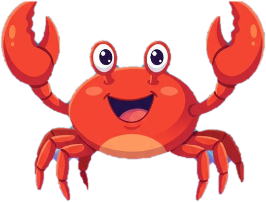
</p>

<h1 align="center">Caranguejodex</h1>

<p align="center">
  Um jogo de missões para o DevFest: explore o evento, conheça pessoas e capture os caranguejos dos patrocinadores.<br>
  Protótipo criado para a code jam do DevFest Aracaju.
</p>

<p align="center">
  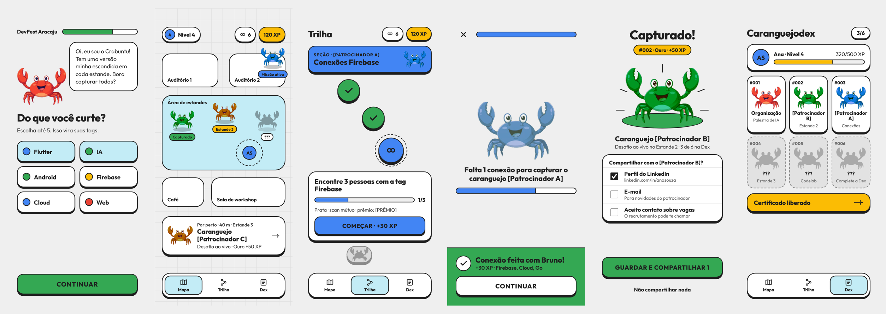
</p>

> **Nome provisório.** "Caranguejodex" é o nome de trabalho; o nome final do app ainda está em aberto.

## Sumário

- [A ideia](#a-ideia)
- [As telas](#as-telas)
- [Como funciona o jogo](#como-funciona-o-jogo)
- [Como rodar o protótipo](#como-rodar-o-protótipo)
- [Estrutura do projeto](#estrutura-do-projeto)
- [Documentação](#documentação)
- [Próximos passos](#próximos-passos)
- [Créditos](#créditos)

## A ideia

Em eventos de tecnologia, as pessoas querem conhecer gente e aprender, mas acabam presas no próprio grupo. As gamificações comuns viram coleta passiva de QR code de estande, com pouca conversa de verdade.

Aqui o jogo só avança com **interação humana real**. O participante cumpre missões criadas pelos patrocinadores: trocar QR com quem tem uma tag em comum, fazer uma pergunta numa palestra, resolver um desafio ao vivo num estande. A cada conjunto de missões, ele captura uma **skin do Crabuntu**, o caranguejo mascote da comunidade. Cada patrocinador tem a sua.

A experiência mistura padrões de dois jogos conhecidos, sem copiar marca nem personagem de nenhum deles:

- **Pokémon GO:** mapa do evento com caranguejos nos estandes, silhuetas dos que ainda não foram descobertos, momento de captura e uma dex para colecionar.
- **Duolingo:** mascote que conversa com a pessoa, trilha de missões em nós, XP com nível, botões em 3D e celebração ao acertar.

O visual segue a identidade das artes do DevFest: fundo cinza-claro, tipografia geométrica pesada, pílulas e cards com contorno preto e as cores do Google.

## As telas

| | |
| :---: | :---: |
| 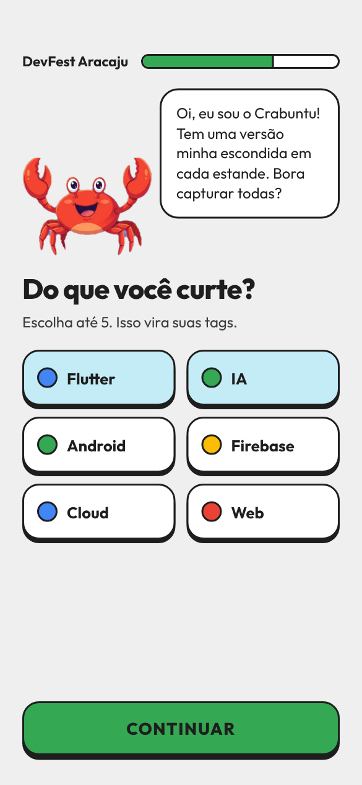<br>**1 · Onboarding**<br>O Crabuntu se apresenta e a pessoa escolhe interesses, que viram suas tags. | 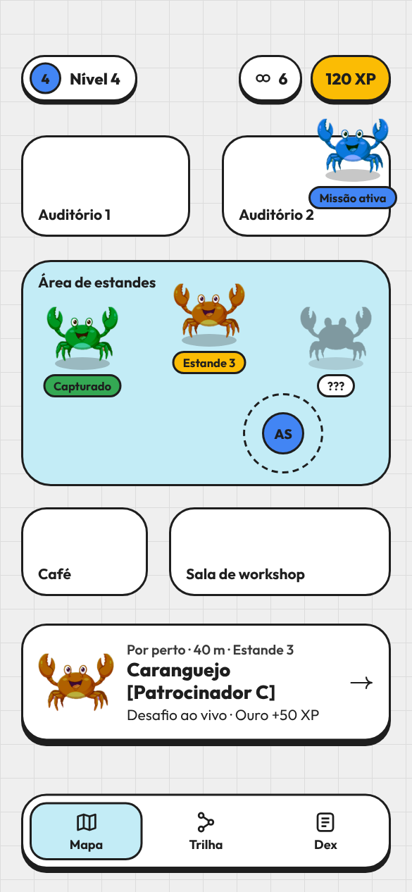<br>**2 · Mapa do evento**<br>Caranguejos nos estandes: os capturados, os disponíveis e os ainda desconhecidos. |
| 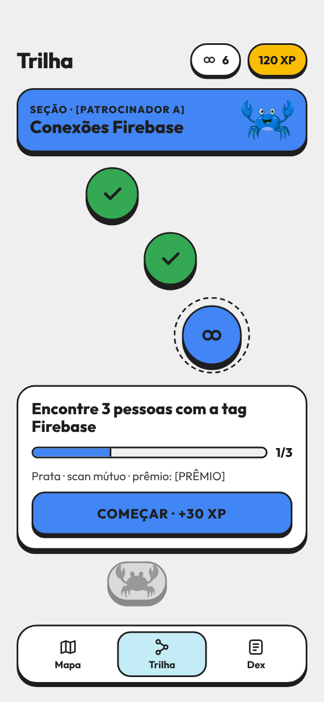<br>**3 · Trilha de missões**<br>Uma seção por patrocinador, com etapas concluídas, a atual e a recompensa no fim. | 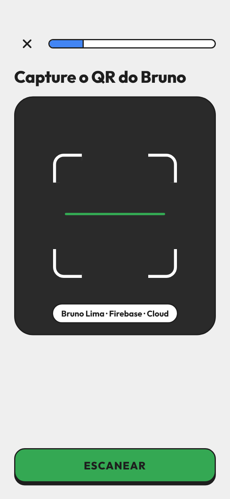<br>**4 · Captura da conexão**<br>Escaneia o QR da outra pessoa, que escaneia o seu em seguida (scan mútuo). |
| 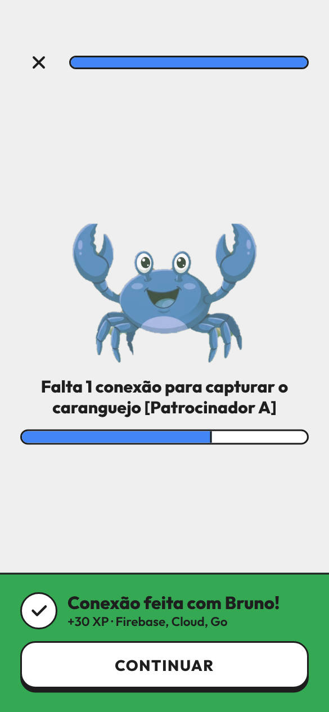<br>**4b · Conexão feita**<br>+30 XP e quanto falta para capturar o caranguejo daquele patrocinador. | 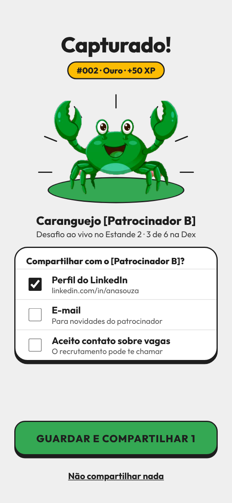<br>**5 · Capturado!**<br>O caranguejo entra na dex e a pessoa escolhe o que compartilhar com o patrocinador. |
| 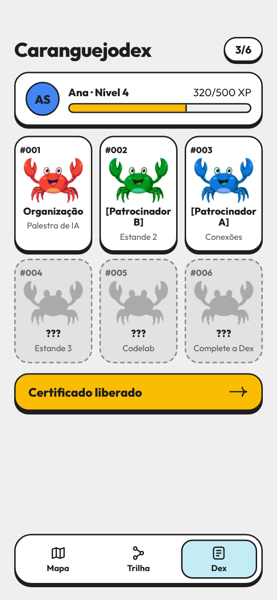<br>**6 · Caranguejodex**<br>Coleção numerada, com silhuetas dos que faltam, e a barra de XP do nível. | 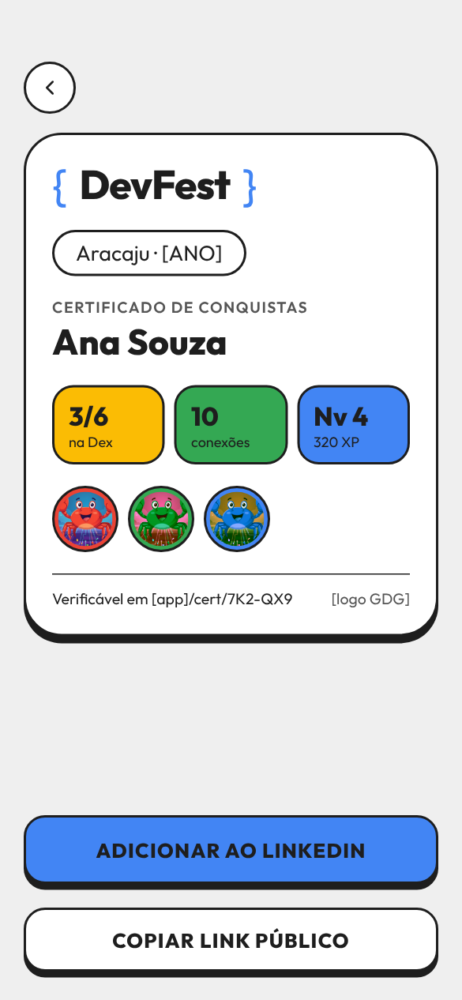<br>**7 · Certificado**<br>Conquistas do evento com link público verificável, pronto para o LinkedIn. |
| 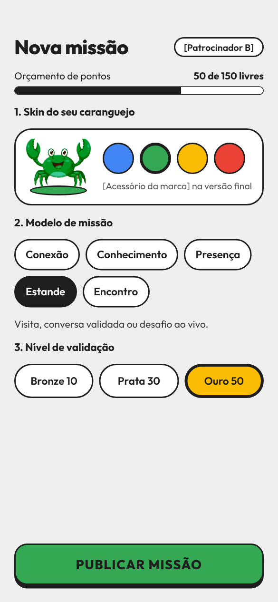<br>**Mock · Painel do patrocinador**<br>Escolhe a skin, o modelo de missão e o nível, dentro do orçamento. | |

## Como funciona o jogo

O XP depende de **como a missão é validada**, não do tipo nem do lugar. Assim, um patrocinador que só tem estande compete em pé de igualdade com quem traz um codelab.

| Nível | XP | Validação |
| --- | --- | --- |
| Ouro | 50 | Desafio concluído (mini-demo, quiz, codelab) |
| Prata | 30 | Outra pessoa confirma (staff ou scan mútuo) |
| Bronze | 10 | Scan simples de QR fixo |

- Patrocinadores criam missões a partir de **5 modelos** (Conexão, Conhecimento, Presença ativa, Desafio de estande, Ponto de encontro) e têm um orçamento igual de **150 pts**.
- O **QR pessoal expira em 60 s** e a conexão exige scan mútuo, o que impede a trapaça do print de QR no grupo.
- **Lead só com consentimento:** ao capturar um caranguejo, o participante escolhe o que compartilha.
- Completar a dex libera o **caranguejo Lendário**. Com 3 missões concluídas, o **certificado** é liberado.

As regras completas estão em [`docs/regras.md`](docs/regras.md).

## Como rodar o protótipo

O protótipo não tem dependências nem build. As telas são componentes no formato do Claude Design (`.dc.html`), e o arquivo `support.js` é um runtime mínimo que permite abri-las em qualquer navegador.

```bash
git clone https://github.com/EdmirSoares/caranguejodex.git
cd caranguejodex/prototipo
python3 -m http.server 8000
```

Abra `http://localhost:8000` e use o modo celular do navegador (390 × 844). Os botões navegam entre as telas, os interesses e as opções de compartilhamento podem ser marcados, e a captura da conexão simula os dois scans.

Para regenerar os prints do README depois de alterar alguma tela:

```bash
pip install playwright pillow
playwright install chromium
python scripts/gerar-prints.py
```

## Estrutura do projeto

```
.
├── README.md
├── docs/
│   ├── regras.md              # regras do jogo
│   ├── roteiro-demo.md        # roteiro do pitch e plano da code jam
│   ├── adr/                   # uma decisão por arquivo (0001 a 0009)
│   ├── specs/                 # features com histórias e critérios de aceite
│   └── imagens/               # mascote e prints das telas
├── prototipo/
│   ├── index.html             # lista das telas
│   ├── *.dc.html              # uma tela por arquivo
│   ├── support.js             # runtime mínimo dos componentes
│   ├── assets/                # imagens do Crabuntu
│   └── fonts/                 # fonte Outfit (OFL)
└── scripts/
    └── gerar-prints.py        # gera os prints em docs/imagens/telas
```

## Documentação

| Documento | Conteúdo |
| --- | --- |
| [Regras do jogo](docs/regras.md) | Níveis de XP, modelos de missão, anti-trapaça, caranguejos, leads, prêmios e certificado |
| [Decisões (ADRs)](docs/adr/README.md) | As 9 decisões de produto, com contexto e consequências |
| [Specs das features](docs/specs/README.md) | 8 features com histórias de usuário e critérios de aceite |
| [Roteiro da demo](docs/roteiro-demo.md) | O pitch de 3 minutos e o plano da hora da code jam |

## Próximos passos

- [ ] Ilustrar as skins reais de cada patrocinador e o caranguejo Lendário (hoje o protótipo só recolore o Crabuntu).
- [ ] Validar as regras com patrocinadores e com a organização do evento.
- [ ] Implementar o app; o QR dinâmico e o scan mútuo são o núcleo técnico.
- [ ] Definir o nome final do app.

## Créditos

- **Crabuntu** é o mascote da comunidade, escolhido por votação.
- Cores e estilo seguem a identidade visual do DevFest. O logo do Google Developer Groups não está incluído: use o arquivo oficial no lugar dos marcadores `[logo GDG]`.
- Nomes entre colchetes, como `[Patrocinador A]` e `[PRÊMIO]`, são marcadores a preencher.
- Fonte [Outfit](https://fonts.google.com/specimen/Outfit), licença SIL Open Font License (`prototipo/fonts/OFL.txt`).
